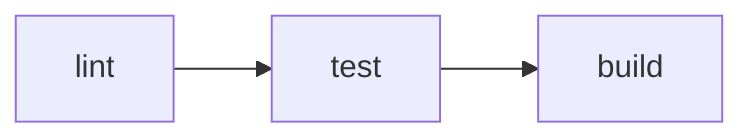

# 任务编排

`vp run` 运行 `package.json` 脚本以及 `vite.config.ts` 中定义的任务。它的行为类似 `pnpm run`，并内置缓存、依赖排序与工作区感知执行。该任务运行器可通过[全局 CLI](/guide/global-cli)与[项目本地 CLI](/guide/local-cli)使用。

> [!TIP]
> `vpr` 可作为 `vp run` 的独立简写使用。下面所有示例同时适用于 `vp run` 与 `vpr`。

## 概述

对现有的 `package.json` 脚本使用 `vp run`：

**package.json**

```json
{
  "scripts": {
    "build": "node compile-legacy-app.js",
    "test": "jest"
  }
}
```

`vp run build` 会执行对应的 build 脚本：

```
$ node compile-legacy-app.js

building legacy app for production...

✓ built in 69s
```

不带任务名运行 `vp run` 会进入交互式任务运行器：

```
Select a task (↑/↓, Enter to run, type to search):

  › build: node compile-legacy-app.js
    test: jest
```

启用 [shell 补全](/guide/env)后，在输入 `vp run` 或 `vpr` 后按 Tab 键，即可从项目中补全任务名。

## 内置命令与脚本

`vp dev` 是内置命令，`vp run dev` 则是你的 `dev` 脚本。内置命令无法被覆盖，因此添加 `dev` 脚本不会改变 `vp dev` 的行为：

| 命令                       | 运行内容                                                              |
| -------------------------- | --------------------------------------------------------------------- |
| `vp dev`                   | 内置的 Vite 开发服务器                                                |
| `vp run dev` / `vpr dev`   | `package.json` 中的 `dev` 脚本，或 `vite.config.ts` 中的 `dev` 任务   |
| `vp test`                  | 内置的 Vitest 命令                                                    |
| `vp run test` / `vpr test` | `package.json` 中的 `test` 脚本，或 `vite.config.ts` 中的 `test` 任务 |

`build`、`preview`、`lint`、`fmt`、`check` 与 `pack` 的行为与此相同。

如果项目定义了对应的脚本或任务，请用 `vp run <name>` 来运行它。例如，当项目中有 `"dev": "astro dev"` 脚本时，`vp run dev` 会启动 Astro，而 `vp dev` 会忽略该脚本并启动 Vite。

## 缓存

`package.json` 脚本默认不缓存。使用 `--cache` 启用缓存：

```bash
vp run --cache build
```

```
$ node compile-legacy-app.js
✓ built in 69s
```

如果没有任何变化，下次运行时输出会直接从缓存中重放：

```
$ node compile-legacy-app.js ◉ cache hit, replaying
✓ built in 69s

---
vp run: cache hit, 69s saved.
```

如果某个输入发生变化，任务会重新运行：

```
$ node compile-legacy-app.js ○ cache miss: 'legacy/index.js' modified, executing
```

## 任务定义

Vite Task 会[自动追踪](/guide/automatic-data-tracking)每个任务用于缓存所需的输入。你可以直接在 `vite.config.ts` 中定义任务，从而默认启用缓存，或控制哪些文件与环境变量会影响缓存行为。

**vite.config.ts**

```ts
import { defineConfig } from 'vite-plus';

export default defineConfig({
  run: {
    tasks: {
      build: {
        command: 'vp build',
        dependsOn: ['lint'],
        cache: {
          env: ['NODE_ENV'],
        },
      },
      deploy: {
        command: 'deploy-script --prod',
        cache: false,
        dependsOn: ['build', 'test'],
      },
    },
  },
});
```

如果你想原样运行已有的 `package.json` 脚本，请使用 `vp run <script>`。如果你需要任务级缓存、依赖关系或环境/输入控制，请定义带显式 `command` 的任务。任务名可以来自 `vite.config.ts` 或 `package.json`，但不能同时来自两者。

> [!NOTE]
> 在 `vite.config.ts` 中定义的任务默认启用缓存，`package.json` 脚本则不会。完整的判定顺序参见[何时启用缓存？](/guide/cache)。

有关 `run` 块的完整参考，请参阅 [run 配置](/config/run)。

## 任务依赖

使用 [`dependsOn`](/config/run) 按正确顺序运行任务。使用上面的配置运行 `vp run deploy` 时，会先运行 `build` 与 `test`。

`dependsOn` 中的字符串任务名引用当前包或另一个包中的任务：

**vite.config.ts**

```ts
dependsOn: [
  'build', // 同一个包
  '@my/core#build', // 另一个包
];
```

当你需要引用当前包依赖中所有具有给定名称的任务时，使用对象形式：

**vite.config.ts**

```ts
import { defineConfig } from 'vite-plus';

export default defineConfig({
  run: {
    tasks: {
      test: {
        command: 'vp test',
        dependsOn: [{ task: 'build', from: 'dependencies' }],
      },
    },
  },
});
```

在这个例子中，`vp run test` 会检查当前包的 `dependencies`。对于每个定义了 `build` 的直接工作区依赖，Vite Task 都会在 `test` 之前运行该依赖的 `build` 任务。

当你需要多个依赖字段时，使用数组：

```ts
dependsOn: [{ task: 'build', from: ['dependencies', 'devDependencies'] }];
```

## 在工作区中运行

不带任何包选择标志时，`vp run` 会在当前工作目录所属的包中运行任务：

```bash
cd packages/app
vp run build
```

你也可以从任意位置显式指定目标包：

```bash
vp run @my/app#build
```

工作区包的排序基于各包 `package.json` 中声明的常规 monorepo 依赖图。换句话说，Vite+ 所说的包依赖指的是工作区包之间常规的 `dependencies` 关系，而不是任务运行器专用的另一张依赖图。

### 递归（`-r`）

在工作区的每个包中按依赖顺序运行任务：

```bash
vp run -r build
```

该依赖顺序来自通过 `package.json` 依赖引用的工作区包。

### 传递（`-t`）

在一个包及其所有依赖中运行任务：

```bash
vp run -t @my/app#build
```

如果 `@my/app` 依赖 `@my/utils`，而 `@my/utils` 又依赖 `@my/core`，则会按顺序运行这三个包。Vite+ 会依据 `package.json` 中声明的常规工作区包依赖解析这条链路。

### 筛选（`--filter`）

按名称、目录或 glob 模式选择包。语法与 pnpm 的 `--filter` 一致：

```bash
# 按名称
vp run --filter @my/app build

# 按 glob
vp run --filter "@my/*" build

# 按目录
vp run --filter ./packages/app build

# 包含依赖
vp run --filter "@my/app..." build

# 包含依赖者
vp run --filter "...@my/core" build

# 排除包
vp run --filter "@my/*" --filter "!@my/utils" build
```

多个 `--filter` 标志会按并集合并。排除筛选会在所有包含筛选之后应用。

当某个 `--filter` 没有匹配到任何包时，Vite+ 会打印警告并成功退出。传入 `--fail-if-no-match` 可以在任一筛选没有匹配时中止运行。

### 工作区根（`-w`）

显式在工作区根包中运行任务：

```bash
vp run -w build
```

## 复合命令

用 `&&` 连接的命令会被拆分为相互独立的子任务。启用[缓存](/guide/cache)时，每个子任务会分别缓存。这对 `vite.config.ts` 中的任务与 `package.json` 脚本都适用：

```json
{
  "scripts": {
    "check": "vp lint && vp build"
  }
}
```

现在运行 `vp run --cache check`：

```
$ vp lint
Found 0 warnings and 0 errors.

$ vp build
✓ built in 28ms

---
vp run: 0/2 cache hit (0%), 2/2 successful.
```

每个子任务都有各自的缓存条目。例如，如果只有构建使用的某个文件（如 `index.html`）发生变化，那么下次调用 `vp run --cache check` 时只会重新运行构建：

```
$ vp lint ◉ cache hit, replaying
$ vp build ○ cache miss: 'index.html' modified, executing
✓ built in 30ms

---
vp run: 1/2 cache hit (50%), 2/2 successful, 120ms saved.
```

### 嵌套的 `vp run`

当命令中包含 `vp run` 时，Vite Task 会将其内联为独立任务，而不是派生一个嵌套进程。每个子任务独立缓存，输出保持扁平：

```json
{
  "scripts": {
    "ci": "vp run lint && vp run test && vp run build"
  }
}
```

运行 `vp run ci` 会展开为三个任务：



标志在嵌套脚本中同样有效。例如，脚本中的 `vp run -r build` 会展开为每个包各自的 build 任务。

> [!NOTE]
> 一种常见的 monorepo 模式是用根脚本递归运行某个任务：
>
> **package.json（根）**
>
> ```json
> {
>   "scripts": {
>     "build": "vp run -r build"
>   }
> }
> ```
>
> 这会形成潜在的递归：根包的 `build` -> `vp run -r build` -> 又包含根包的 `build` -> ...
>
> Vite Task 会检测并自动剪除这种自引用，因此其他包可以正常构建。

## 执行摘要

使用 `-v` 显示详细的执行摘要：

```bash
vp run -r -v build
```

```
━━━━━━━━━━━━━━━━━━━━━━━━━━━━━━━━━━━━━━━━━━━━━━━
    Vite+ Task Runner • Execution Summary
━━━━━━━━━━━━━━━━━━━━━━━━━━━━━━━━━━━━━━━━━━━━━━━

Statistics:   3 tasks • 3 cache hits • 0 cache misses
Performance:  100% cache hit rate, 468ms saved in total

Task Details:
────────────────────────────────────────────────
  [1] @my/core#build: ~/packages/core$ vp build ✓
      → Cache hit - output replayed - 200ms saved
  ·······················································
  [2] @my/utils#build: ~/packages/utils$ vp build ✓
      → Cache hit - output replayed - 150ms saved
  ·······················································
  [3] @my/app#build: ~/packages/app$ vp build ✓
      → Cache hit - output replayed - 118ms saved
━━━━━━━━━━━━━━━━━━━━━━━━━━━━━━━━━━━━━━━━━━━━━━━
```

使用 `--last-details` 可以在不重新运行任务的情况下显示上一次运行的摘要：

```bash
vp run --last-details
```

## 并发

默认最多同时运行 4 个任务。使用 `--concurrency-limit` 更改此上限：

```bash
# 最多同时运行 8 个任务
vp run -r --concurrency-limit 8 build

# 一次只运行一个任务
vp run -r --concurrency-limit 1 build
```

也可以通过 `VP_RUN_CONCURRENCY_LIMIT` 环境变量设置该上限。`--concurrency-limit` 标志的优先级高于环境变量。

### 并行模式

使用 `--parallel` 忽略任务依赖，以无限并发一次性运行所有任务：

```bash
vp run -r --parallel dev
```

当任务彼此独立且你希望获得最大吞吐量时，这很有用。你可以把 `--parallel` 与 `--concurrency-limit` 结合使用，从而在不按依赖排序的情况下运行任务，同时仍然限制并发任务数：

```bash
vp run -r --parallel --concurrency-limit 4 dev
```

## 附加参数

任务名之后的参数会透传给任务命令：

```bash
vp run test --reporter verbose
```
